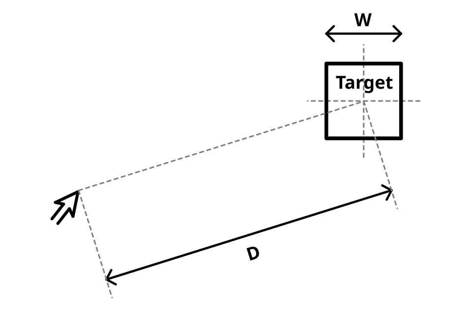
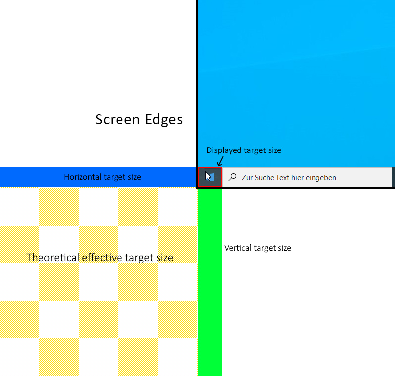
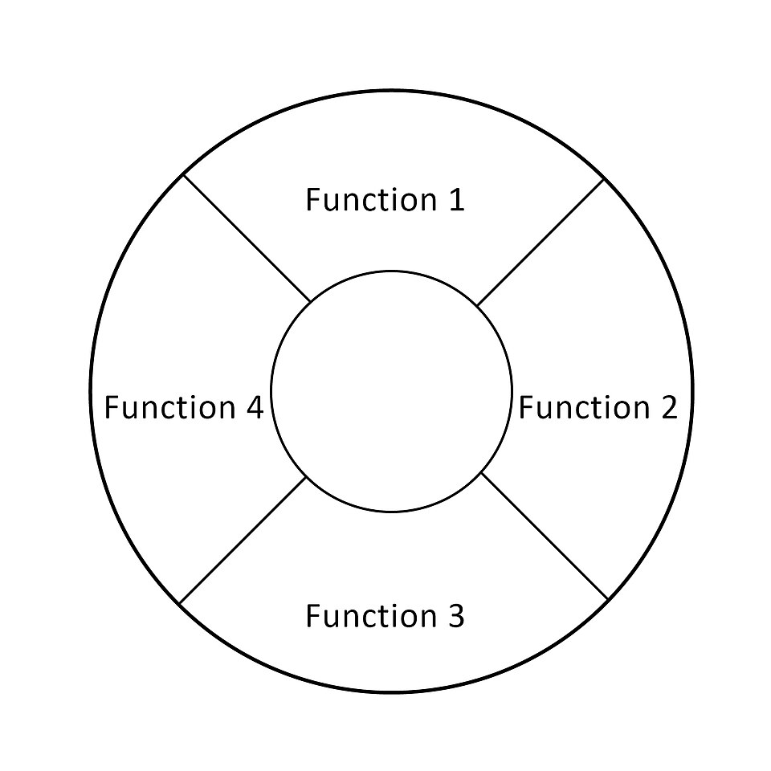

# Chapitre 6 — Les lois de l'UX et la psychologie de l'utilisateur

> Les « lois de l'UX » regroupent des résultats de psychologie cognitive et de recherche en IHM
> réinterprétés pour le design. Le site *Laws of UX* de Jon Yablonski [S21] en recense trente.
> Elles guident, elles ne **prouvent** rien à elles seules : toujours vérifier par un test.


*Figure 6.1 — Loi de Fitts : le temps de mouvement dépend de la distance D à la cible et de sa
largeur W. Illustration Wikimedia Commons (CC BY-SA 4.0).*

## 6.1 Laws of UX : vue d'ensemble

| Domaine | Lois |
|---|---|
| **Décision et action** | Fitts, Hick, Choice overload, Doherty, Goal-gradient, Parkinson, Postel, Tesler |
| **Mémoire et charge** | Miller, Chunking, Working memory, Cognitive load, Serial position, Zeigarnik |
| **Perception (Gestalt)** | Proximité, Similarité, Région commune, Connexité uniforme, Prägnanz, Von Restorff |
| **Modèles et attentes** | Jakob, Modèle mental, Paradoxe de l'utilisateur actif, Aesthetic-usability |
| **Expérience et motivation** | Peak-end, Flow, Selective attention, Cognitive bias |
| **Méthode** | Occam, Pareto |

## 6.2 Décision et action

### Loi de Fitts (1954)

**Énoncé.** Le temps pour atteindre une cible dépend de la **distance** qui l'en sépare et de sa
**taille** [S31].

**Origine.** Paul Fitts a publié en 1954 *The information capacity of the human motor system in
controlling the amplitude of movement*. NN/g [S22] rappelle que Fitts, qui a étudié le design
des cockpits pendant la Seconde Guerre mondiale, fut l'un des premiers à comprendre que
l'« erreur humaine » relevait souvent d'un mauvais design. Influencé par la théorie de
l'information de Shannon, il cherchait la « bande passante » du mouvement humain.

**Formule** (forme de Shannon, la plus utilisée en IHM [S23]) :

```
T = a + b · log₂( D / W + 1 )
```

`D` = distance à la cible, `W` = largeur (mesurée selon l'axe du mouvement ; pour une cible
rectangulaire d'interface on retient la plus petite dimension [S22]), `a` et `b` = constantes
selon le pointeur (souris, doigt…). `log₂(D/W + 1)` est l'**indice de difficulté**, en bits. Le
logarithme implique qu'une cible deux fois plus loin n'exige pas deux fois plus de temps :
le mouvement accélère puis ralentit [S22].

**Modèle à deux composantes** (Woodworth, fin XIXᵉ) [S22] : un mouvement initial rapide
et grossier, dominé par la distance ; un mouvement final lent qui assure la précision, dominé
par la **taille** de la cible.

**Applications [S22][S31]**

- **Plus grand = mieux** : temps réduit *et* taux d'erreur réduit. Les tailles minimales
  sont d'ordinaire fixées en cherchant la taille où le taux d'erreur se stabilise.
- **Icône + libellé** : la cible (icône + texte) est plus grande qu'une icône seule, donc plus
  facile à atteindre — **à condition de rendre tout le bloc cliquable**.
- **Bords et coins de l'écran** : une cible collée au bord est « infinie » sur un axe, car le
  pointeur s'arrête au bord ; le coin cumule deux bords (les *magic corners*) [S23].
- **Espacer généreusement** les cibles tactiles ; les placer là où le pouce arrive.
- **Menus contextuels / radiaux** qui apparaissent au pointeur réduisent les trajets [S23].


*Figure 6.2 — Les « coins magiques » : un coin d'écran est une cible théoriquement infinie.
Wikimedia Commons (CC BY-SA 4.0).*


*Figure 6.3 — Un menu radial place toutes les options à même distance du pointeur.
Wikimedia Commons (CC BY-SA 4.0).*

### Loi de Hick-Hyman (1952)

**Énoncé.** Le temps de décision augmente avec le nombre et la complexité des choix [S30].
Hick et Hyman (1952) ont montré que davantage de stimuli allonge le temps de réaction.

**Formule** [S24] : `T = b · log₂(n + 1)`. Doubler le nombre de choix **n'est pas** doubler
le temps ; l'augmentation devient de plus en plus faible quand n croît.

**Points clés [S30]**

- Limiter les choix quand la rapidité compte.
- **Découper** les tâches complexes en étapes plus petites.
- **Mettre en avant** l'option recommandée.
- **Onboarding progressif** : introduire les fonctions peu à peu.
- Attention : trop simplifier rend l'interface abstraite ou floue.

**Exemples [S30]** : la page d'accueil de Google (une seule tâche) ; la télécommande Apple TV
(la complexité est dans l'interface organisée en menus) ; l'onboarding de Slack (un bot apprend
d'abord la messagerie, les autres fonctions restent cachées).

### Surcharge de choix (Choice overload)

Les choix trop nombreux nuisent à la décision et au ressenti global ; notion introduite par
Alvin Toffler en 1970 (*Future Shock*) [S32]. Remèdes : **comparaison côte à côte** quand elle
est nécessaire (ex. offres tarifaires) ; **prioriser** ce qui est montré (produit vedette) ;
fournir en amont des outils de réduction (recherche, filtres).

### Seuil de Doherty (1982)

Productivité maximale quand ordinateur et utilisateur interagissent assez vite (**< 400 ms**)
pour qu'aucun n'attende l'autre [S27]. Doherty et Thadani (IBM Systems Journal, 1982) ont
proposé 400 ms en remplacement de l'ancien standard de 2 s.

À retenir [S27] : feedback sous 400 ms ; la **performance perçue** compte autant que la réelle ;
l'animation occupe l'attention pendant un traitement ; une barre de progression rend l'attente
plus tolérable même approximative ; un délai *délibéré* peut accroître la valeur perçue d'un
résultat (voir chap. 15 pour les limites de temps de NN/g).

### Goal-gradient

La tendance à s'approcher d'un but augmente avec la proximité du but (Clark Hull, 1932) [S32].
Plus l'utilisateur est près de finir, plus il accélère. **Indiquer clairement la progression**
(étapes 2/4, barre) motive l'achèvement.

### Loi de Parkinson

Toute tâche se dilate jusqu'à occuper le temps disponible (1955) [S32]. Limiter la durée d'une
tâche à ce que l'utilisateur en attend ; l'**autocomplétion** et le remplissage automatique
évitent l'inflation.

### Loi de Postel (principe de robustesse)

« Soyez libéral dans ce que vous acceptez, conservateur dans ce que vous envoyez » [S32].
Tolérer des saisies variables (espaces, majuscules, séparateurs), les normaliser, définir
des limites claires et informer.

> **Application directe.** C'est exactement la normalisation de ScanList (trim + espaces
> internes réduits à l'écriture) : accepter large en entrée, stocker strict.

### Loi de Tesler (conservation de la complexité)

Tout système contient un noyau de complexité irréductible qui doit être assumé **soit par le
système, soit par l'utilisateur** [S32]. Larry Tesler (Xerox PARC, années 1980) soutenait qu'un
ingénieur devrait passer une semaine de plus à réduire la complexité plutôt que de faire perdre
une minute à chaque utilisateur. Ne pas concevoir pour un utilisateur idéal et rationnel.

## 6.3 Mémoire et charge cognitive

### Loi de Miller (1956)

On retient environ **7 ± 2** éléments en mémoire de travail [S25]. George Miller a montré que
l'empan immédiat et le jugement absolu sont limités à environ sept éléments, avec le **bit**
comme unité.

**Mises en garde [S25]** : ne pas utiliser le « nombre magique sept » pour justifier des limites
arbitraires de design ; la capacité varie selon l'individu, ses connaissances et le contexte.
Les recherches ultérieures (Cowan) évoquent plutôt **4 ± 1** unités ; le dossier retient la
fourchette « 4 à 7 » donnée par [S32].

### Chunking (regroupement)

Découper l'information et la regrouper en ensembles porteurs de sens [S32]. Aide au
balayage visuel (scan) : modules distincts, règles de séparation, hiérarchie claire. Exemples
courants : numéros de téléphone groupés par paires.

### Mémoire de travail (Working memory)

Système qui conserve temporairement l'information nécessaire à une tâche : **4 à 7 unités**, qui
s'effacent en 20-30 secondes [S32]. Principes : favoriser la **reconnaissance** plutôt que le
rappel (liens visités différenciés, fil d'Ariane) ; **porter la charge mémoire par le système**
(reporter les informations d'un écran à l'autre, tableaux comparatifs).

### Charge cognitive (Sweller)

Quantité de ressources mentales nécessaires pour comprendre et utiliser une interface [S28].
John Sweller a développé la théorie dans les années 1980 en étendant les travaux de Miller.

| Type | Définition [S28] | Levier du designer |
|---|---|---|
| **Intrinsèque** | Effort pour retenir l'information utile au but, intégrer de nouvelles informations, suivre ses objectifs | Découper en étapes, ordonner |
| **Extrinsèque** | Traitement qui consomme des ressources sans aider à comprendre (éléments distrayants, inutiles) | **Supprimer** |

NN/g propose aussi des principes pour limiter la charge cognitive (article *Minimize Cognitive
Load to Maximize Usability*, cité dans [S28]).

### Effet de position sérielle

On retient mieux le **premier** et le **dernier** éléments d'une série (Ebbinghaus : effets de
primauté et de récence) [S32]. Mettre les éléments les moins importants au milieu des listes ;
placer les actions clés aux extrémités (à gauche et à droite d'une barre de navigation).

### Effet Zeigarnik

On se souvient mieux des tâches inachevées ou interrompues que des tâches terminées (Bluma
Zeigarnik, années 1920) [S32]. Signifier qu'il reste du contenu ; **indiquer la progression**.

## 6.4 Perception et attention

Les lois gestaltistes (proximité, similarité, région commune, connexité uniforme, continuité,
fermeture, Prägnanz) sont détaillées au **chapitre 7** avec leurs illustrations.

### Effet Von Restorff (isolation)

Parmi des objets semblables, celui qui diffère est le plus mémorisé (Hedwig von Restorff,
1933) [S32]. Rendre distinctifs les informations ou actions clés **avec retenue** (trop
d'emphases se concurrencent ; un élément trop saillant peut être pris pour une publicité). **Ne
pas s'appuyer uniquement sur la couleur** (daltonisme, basse vision) et ménager les personnes
sensibles au mouvement.

### Attention sélective

On ne traite que le sous-ensemble de stimuli lié à nos buts [S32]. Deux phénomènes :

- **Cécité aux bannières** : on ignore le contenu qui ressemble à de la publicité ou se trouve
  près d'elle → ne pas styliser un contenu comme une pub.
- **Cécité au changement** : des changements notables passent inaperçus faute d'indices forts →
  éviter les changements simultanés concurrents.

Les théories fondatrices : filtre de Broadbent (1958), effet « cocktail party » de Cherry
(1953) [S32].

## 6.5 Modèles et attentes

### Loi de Jakob

Les gens passent l'essentiel de leur temps sur *d'autres* sites et attendent que le vôtre
fonctionne pareil [S26]. Les contrôles de formulaire (interrupteurs, boutons radio) ont été
modélisés sur leurs équivalents physiques. Lors d'un changement, **laisser temporairement
l'ancienne version** : en 2017, YouTube a laissé les utilisateurs de bureau prévisualiser le
nouveau design Material, donner leur avis et revenir en arrière [S26].

### Modèle mental

Représentation simplifiée de ce que nous pensons savoir d'un système et de son fonctionnement ;
formulé par Kenneth Craik (1943) [S32]. NN/g [S19] précise : un modèle mental repose sur la
**croyance, pas sur les faits** ; chaque utilisateur a le sien ; le grand dilemme est l'**écart
entre les modèles mentaux des concepteurs et ceux des utilisateurs** — les concepteurs, qui
connaissent leur œuvre en détail, croient chaque fonction facile à comprendre. On réduit cet
écart par des entretiens, personas, cartes de parcours, cartes d'empathie [S32].

### Paradoxe de l'utilisateur actif (Rosson & Carroll, 1987)

Les utilisateurs ne lisent pas les manuels ; ils démarrent aussitôt, même au prix d'erreurs
[S32]. Rendre les consignes accessibles **en contexte** (infobulles utiles).

### Effet esthétique-usabilité (Kurosu & Kashimura, 1995)

Les utilisateurs perçoivent le design agréable comme plus utilisable [S32]. Étude fondatrice :
26 variantes d'une interface de distributeur de billets, 252 participants ; la corrélation
entre beauté et facilité *perçue* dépassait celle entre beauté et facilité *réelle*.

NN/g [S18] nuance :

- une interface attrayante rend **tolérant aux petits problèmes, pas aux gros** ;
- elle peut **masquer** des défauts lors des tests : atténuer l'effet par de meilleures tâches ;
- exemple : un participant ravi des grandes photos d'un site de conseil finit agacé après
  plusieurs tâches difficiles (« génial la première fois… sûrement agaçant la deuxième ») ;
- le bon design ne peut pas être seulement fonctionnel : **l'attrait visuel n'est pas un luxe**.

## 6.6 Expérience et motivation

### Règle pic-fin (Peak-end)

On juge une expérience d'après son **pic** émotionnel et sa **fin**, non la somme ou la moyenne
[S32]. Étude de Kahneman, Fredrickson, Schreiber et Redelmeier (1993). Soigner les moments
les plus intenses et la fin du parcours ; on se rappelle plus vivement les expériences
négatives. Exemples cités : Mailchimp (la confirmation d'envoi, moment stressant, est adoucie
par illustration, animation et humour) ; Uber (travail sur la perception de l'attente pour
réduire l'annulation après la demande).

### Flow (Csíkszentmihályi, 1975)

État d'immersion énergique [S32]. Il naît de l'**équilibre entre difficulté et compétence** :
trop dur → frustration, trop facile → ennui. Pour le favoriser : feedback sur l'action
accomplie, réactivité, suppression des frictions.

### Biais cognitifs

Erreurs systématiques de jugement (Tversky et Kahneman, 1972) fondées sur des heuristiques de
jugement ; exemple : le biais de confirmation [S32]. En connaître l'existence aide à les
repérer, chez soi (concepteur) comme chez l'utilisateur.

## 6.7 Méthode : Occam et Pareto

- **Rasoir d'Occam** : à pouvoir prédictif égal, retenir l'explication qui fait le moins
  d'hypothèses. En design : analyser chaque élément, retirer tout ce qui peut l'être sans nuire à
  la fonction ; ne considérer l'ouvrage fini que lorsqu'on ne peut plus rien enlever [S32].
- **Principe de Pareto** : ~80 % des effets viennent de ~20 % des causes ; concentrer l'effort
  sur les zones qui profitent au plus grand nombre d'utilisateurs [S32].

## 6.8 Comment utiliser les lois sans en abuser

1. **Aucune loi ne remplace un test.** Les lois sont des hypothèses de départ.
2. **Lire les conditions d'origine.** Miller portait sur l'empan de mémoire, pas sur « 7 items
   max dans un menu » [S25].
3. **Quantifier quand c'est possible** : tailles de cibles (Fitts), temps de réponse (Doherty).
4. **Combiner** : une bonne liste d'inventaire applique à la fois Hick (peu de choix), Miller
   (regroupements), Proximité (espacements), Von Restorff (l'élément actif se distingue) et
   Fitts (cibles grandes).

---
*Sources du chapitre : S19, S21–S32.*
