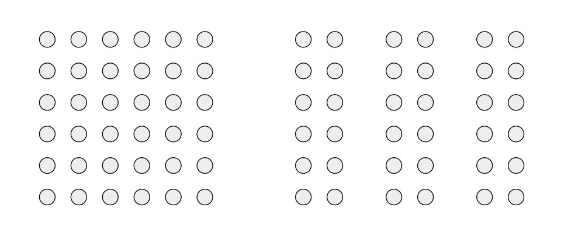
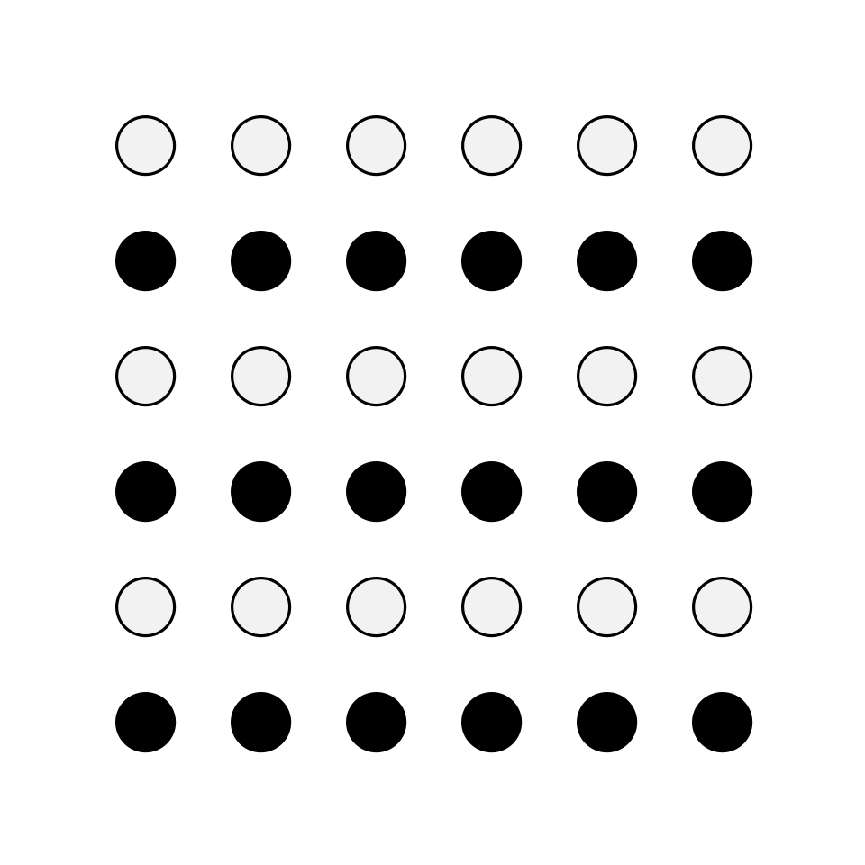
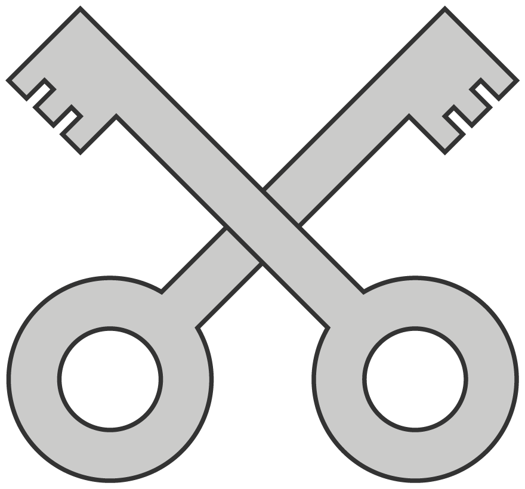

# Chapitre 7 — Perception visuelle : Gestalt, hiérarchie, lecture

> Avant de comprendre une interface, on la **voit**. Les lois de la perception décident de ce
> qui est perçu comme groupé, important, cliquable — et de ce qui est ignoré.

## 7.1 Les principes de la Gestalt

La Gestalt (psychologie de la forme) est née dans la première moitié du XXᵉ siècle : des
psychologues cherchaient comment les gens décident si des éléments appartiennent ou non au même
groupe [S33]. Ils ont observé que l'être humain perçoit naturellement des **ensembles organisés**
(principe de **Prägnanz**, ou « bonne forme ») et ont proposé des règles de regroupement :
proximité, similarité, continuité, fermeture, connexité ; d'autres principes (comme la région
commune) se sont ajoutés plus tard [S33][S32].

| Principe | Énoncé | Usage en interface |
|---|---|---|
| **Proximité** | Les éléments proches sont perçus comme liés | Espacement entre groupes de champs |
| **Similarité** | Les éléments semblables (couleur, forme, taille, orientation) sont perçus comme un groupe | Tous les liens ont le même style |
| **Région commune** | Les éléments dans une zone délimitée forment un groupe | Cartes, encadrés, fonds |
| **Connexité uniforme** | Les éléments reliés visuellement sont perçus comme plus liés | Lignes, flèches, cadres communs |
| **Continuité** | L'œil suit les lignes et courbes plutôt que de changer de direction | Alignements, flux |
| **Fermeture** | L'esprit complète les formes incomplètes | Logos, icônes en pointillé |
| **Prägnanz** | Une image ambiguë est perçue dans sa forme la plus simple | Formes simples, mises en page claires |

*Figure 7.1 — Loi de proximité : les éléments proches sont perçus comme un groupe.
Wikimedia Commons (domaine public).*

*Figure 7.2 — Loi de similarité : les objets partageant des caractéristiques visuelles sont
perçus comme liés. Wikimedia Commons (domaine public).*

*Figure 7.3 — Loi de fermeture : l'esprit perçoit des figures incomplètes comme des formes
entières. Wikimedia Commons (domaine public).*

*Figure 7.4 — Loi de continuité : des objets qui se croisent sont perçus comme ininterrompus.
Wikimedia Commons (domaine public).*

## 7.2 La proximité en détail (NN/g)

D'après Aurora Harley [S33] :

- La proximité est « l'un des principes de regroupement les plus importants » et peut même
  **l'emporter sur d'autres indices** visuels concurrents comme la similarité de couleur ou de
  forme.
- **Faire varier l'espace blanc** pour unir ou séparer : sur le site d'une mairie, l'espace
  supplémentaire entre la navigation principale et la recherche signale que ce sont deux
  fonctions distinctes ; sur petit écran, où l'espace manque, la recherche est déplacée plus
  haut pour éviter l'amalgame (**la proximité peut changer en responsive**).
- Appliquée au **texte** : les phrases sont groupées en paragraphes séparés par du blanc ; un
  titre est plus proche de *son* texte que du texte précédent.
- Appliquée aux **formulaires** (chunking) : douze champs en un bloc semblent rebutants ; les
  mêmes douze en trois groupes de quatre paraissent simples (si les groupes sont cohérents :
  livraison, facturation…). Un faible écart entre une étiquette au-dessus et son champ, et un
  écart plus grand avant la paire suivante, rend la relation évidente.
- **Regrouper des éléments sans lien les camoufle** : sur un site administratif, le bouton
  permettant de lister les informations employeur était noyé parmi *Suivant*, *Enregistrer le
  brouillon*, *Annuler*. L'utilisateur juge souvent le groupe d'après un seul de ses éléments.
- **Éléments éloignés = éléments ignorés** (« vision en tunnel ») : un lien « Passer » en coin
  d'écran, loin des appels à l'action, fait croire à tort que la création de compte est
  obligatoire.

## 7.3 La hiérarchie visuelle

Définition [S34] : l'organisation des éléments pour que l'œil les consomme **dans l'ordre
d'importance voulu**. Trois leviers : couleur et contraste, échelle, regroupement.

### 1. Couleur et contraste

- Ce n'est pas la couleur absolue qui crée la hiérarchie, mais le **contraste de valeur et de
  saturation** entre l'élément et son contexte.
- Un contraste typographique (graisse, italique, soulignement) signale aussi l'importance.
- Bonnes pratiques [S34] :
  - jouer sur la **saturation** : couleurs vives pour l'important, moins saturées pour le
    secondaire ; **réserver les couleurs chaudes vives (rouge) aux alertes et erreurs** ;
  - **ne pas multiplier les couleurs** : pour un design simple, **2 primaires et 2
    secondaires** au plus ;
  - **ne pas multiplier les contrastes** : **3 variations maximum** pour un design complexe —
    « si tout est contrasté, rien ne ressort » ;
  - **ne pas se fier à la couleur seule** (daltonisme).

### 2. Échelle

- Plus un élément est grand, plus il attire l'attention.
- **3 tailles maximum** (petit, moyen, grand) ; pour le web : environ 14-16 px pour le texte,
  18-22 px pour le sous-titre, jusqu'à 32 px pour le titre [S34].
- Plus important = plus grand ; **au plus 2 éléments « grands »**.

### 3. Regroupement : proximité et région commune

- Implicite par la proximité et l'espace blanc ; explicite par l'enceinte (bordure, fond).
- « **Laissez respirer** » : un élément entouré de plus d'espace est perçu comme un groupe à
  part et reçoit plus d'attention.
- Un conteneur (bordure, fond) renforce le signal quand le blanc ne suffit pas — à utiliser
  avec parcimonie car il ajoute du bruit visuel.
- Exemple Spotify (iPhone) : trois groupes nets grâce à des espacements volontairement
  inégaux (plus grands entre groupes, plus petits entre titre et contenu) [S34].

### Le test du plissement d'yeux (squint test)

Flouter légèrement le design (ou plisser les yeux) fait apparaître la hiérarchie sous-jacente
[S34]. Sur l'exemple Spotify, un flou de 5 à 10 px confirme que la section *Écoutés récemment*
domine ; à 20 px, un élément très coloré devient involontairement le plus saillant. Leçon : **il
faut concevoir aussi pour le contenu qui remplira le gabarit** (une photo d'actualité très
colorée peut écraser un titre secondaire).

> Avant de dessiner : définir la hiérarchie du contenu et le(s) message(s) clé(s), puis la
> traduire par couleur/contraste, échelle, regroupement ; enfin tester auprès des
> utilisateurs [S34].

## 7.4 Comment les gens lisent un écran : modèles de balayage

### Le motif en F (NN/g, 2006, revisité 2017)

D'après Kara Pernice [S35] :

- Un motif de balayage où les fixations se concentrent **en haut et à gauche** : une première
  barre horizontale en haut du contenu, une deuxième barre plus courte plus bas, puis une barre
  verticale le long du bord gauche (la « hampe » du F).
- Conséquences : les premières lignes reçoivent plus de regards ; les premiers mots de chaque
  ligne aussi.
- Constaté en 2017 **sur ordinateur et sur mobile**, et en **miroir** dans les langues écrites
  de droite à gauche (arabe).
- Le F apparaît quand **trois éléments sont réunis** [S35] : (1) une page ou section avec un
  texte peu ou pas mis en forme pour le web (« mur de texte » sans gras, puces ni sous-titres) ;
  (2) un utilisateur qui cherche à être le plus efficace possible ; (3) un utilisateur pas assez
  engagé pour lire chaque mot. Sans signal pour guider l'œil, les gens prennent le chemin de
  moindre effort et dépensent leurs fixations près de leur point de départ (en haut à gauche).
- **C'est négatif pour l'utilisateur comme pour l'entreprise** : les phrases ignorées sont
  souvent aussi importantes que celles lues, et l'utilisateur ne sait pas ce qu'il n'a pas vu.
  Un bon formatage réduit l'effet ; les gros blocs non formatés seront balayés en F.
- **Antidotes [S35]** : mettre les points essentiels dans les deux premiers paragraphes ; titres
  et sous-titres bien visibles, **commençant par les mots les plus informatifs** ; regrouper
  visuellement de petites quantités de contenu (bordure, fond) ; mettre en gras les mots
  importants ; formater les liens avec des **mots porteurs de sens** (pas « cliquez ici »), ce
  qui aide aussi l'accessibilité ; utiliser puces et numéros pour listes et procédures ; supprimer
  le contenu inutile.
- **Ce n'est pas le seul motif** : *layer-cake* (l'œil lit les titres et saute le texte),
  *spotted* (saute de gros blocs à la recherche d'un lien, d'un chiffre ou d'un mot de forme
  distinctive), *marking* (regard fixé pendant le défilement ; plus fréquent sur mobile),
  *bypassing* (saute les premiers mots répétés d'une liste), *commitment* (lit presque tout,
  si motivation forte — ne pas y compter).

### Défilement et attention

NN/g [S36], à partir de 130 000 fixations de 120 participants (écrans 1920×1080) :

| Mesure | 2010 | 2018 |
|---|---|---|
| Part du temps de regard **au-dessus du pli** | 80 % | ≈ 57 % |
| Part du temps dans les **deux premiers écrans** (jusqu'à 2160 px) | — | 74 % |
| Part du temps dans les **20 % supérieurs** de la page | — | > 42 % (47 % sur pages de résultats de recherche) |

La conclusion de l'article : le comportement a évolué (on défile plus), mais **l'attention
chute nettement après le pli**, comme en 2010. Mettre l'essentiel en haut reste la règle.

### Traduire en consignes d'interface

1. **Mettre l'information-clé et l'action principale dans la première zone visible.**
2. **Mettre en forme pour le balayage** : titres, listes, mots clés en gras (pas partout), blocs
   courts.
3. **Placer les éléments liés près les uns des autres** (proximité) et les actions qui
   concernent un contenu près de ce contenu.
4. **Tester** avec un vrai contenu, pas avec du lorem ipsum.

## 7.5 Autres notions perceptives utiles

| Notion | Idée | Source |
|---|---|---|
| **Multistabilité** | Une même image admet plusieurs interprétations (cube de Necker, vase de Rubin) | [S37] |
| **Réification** | L'esprit comble l'information spatiale absente | [S37] |
| **Invariance** | Les formes simples sont reconnues malgré rotation, échelle, déformation | [S37] |

*Figure 7.5 — Cube de Necker et vase de Rubin : une image, deux perceptions. Wikimedia Commons
(domaine public).*

---
*Sources du chapitre : S32–S37.*
