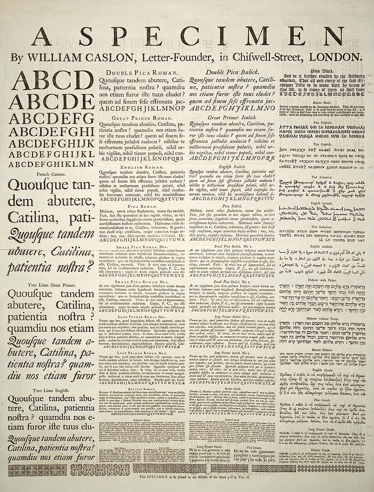

# Chapitre 8 — Typographie

> Sur la plupart des écrans, **l'interface est du texte**. La typographie est donc le premier
> outil de hiérarchie, de lisibilité et de ton.

*Figure 8.1 — Spécimen de caractères de William Caslon (XVIIIᵉ siècle). Wikimedia Commons
(domaine public). Voir `images/CREDITS.md`.*

## 8.1 Vocabulaire minimal

| Terme | Définition (d'après les sources) |
|---|---|
| **Empattement (serif)** | Petit trait attaché à l'extrémité d'un trait plus grand dans une lettre ; une police sans ces traits est **sans-serif** (« grotesque » ou « gothique » dans certains usages) [S40] |
| **Interlignage (leading)** | Espace entre lignes de texte ; en typographie au plomb, épaisseur des lames de plomb insérées entre les lignes. « 10 sur 12 pt » = corps 10, 12 de ligne à ligne, soit 2 pt d'interlignage [S39] |
| **Crénage (kerning)** | Ajustement de l'espace entre **deux** caractères précis ; à ne pas confondre avec le **tracking** (espacement uniforme sur une plage de caractères) [S41] |
| **Légibilité (legibility)** | Perception : capacité à *distinguer* les caractères (taille, dessin de la police, casse) [S38] |
| **Lisibilité (readability)** | Compréhension : facilité de lecture du texte *dans son ensemble* (marges, espacement des mots et des lignes, structure) [S38] |

Précision utile de [S38] : « la légibilité renvoie à la perception, la lisibilité à la
compréhension ». Les majuscules seules réduisent la légibilité. Les yeux saisissent environ trois
mots à la fois et se fatiguent si la ligne exige plus de trois ou quatre sauts saccadés [S38].

## 8.2 Classification des polices à empattements

Quatre sous-groupes, par ordre d'apparition : **old-style, transitional, didone, slab serif**
[S40]. Les empattements viennent probablement des inscriptions romaines gravées (hypothèse du
Père Catich, 1968, « largement mais non universellement acceptée ») [S40].

> **Serif ou sans-serif à l'écran ?** Avant l'ère numérique, les polices à empattements étaient jugées
> plus lisibles ; **aujourd'hui, les sans-serif ont une légibilité comparable, parfois meilleure
> sur écran** (les empattements se rendent moins bien en basse résolution), selon le glossaire NN/g
> de 2024 [S200]. Le ton diffère : les sans-serif paraissent souvent **modernes, froides,
> impersonnelles** ; les serif **traditionnelles, chaleureuses, onéreuses, démodées** [S200].
> Wikipédia rapporte l'ancienne idée contraire [S38]. Dans tous les cas : **tester sur l'appareil
> cible, à la taille réelle**.

## 8.3 L'interlignage

- Robert Bringhurst (*The Elements of Typographic Style*) recommande **plus** d'interlignage
  pour les lignes longues et pour les polices de graisse plus forte, à grande hauteur d'x, à axe
  vertical ou sans empattements [S39].
- Matthew Butterick recommande un interlignage de **20 à 45 % de la taille de la police** [S39]
  (soit un rapport ligne/corps d'environ 1,2 à 1,45).
- Texte « compact » (sans interlignage) : ascendantes et descendantes se touchent, l'œil suit
  mal la ligne. Trop d'interlignage : l'œil perd la continuité [S39].
- Le « simple interligne » des traitements de texte est souvent réglé à 1,15 em [S39].

## 8.4 Les exigences d'accessibilité sur le texte (WCAG)

Critère 1.4.12 *Espacement du texte* (niveau AA) [S43] : le contenu ne doit perdre ni
information ni fonction lorsque l'**utilisateur** impose :

- hauteur de ligne ≥ **1,5 × la taille de police** ;
- espace après les paragraphes ≥ **2 ×** la taille de police ;
- espacement des lettres ≥ **0,12 ×** la taille ;
- espacement des mots ≥ **0,16 ×** la taille.

Il n'oblige pas à *utiliser* ces valeurs : il oblige à **ne pas casser** la mise en page si
l'utilisateur les applique. Conséquence de conception : **pas de hauteurs fixes** pour les
conteneurs de texte, pas de textes qui débordent ou se superposent.

## 8.5 Échelles typographiques : l'exemple de Material 3

Material Design 3 définit cinq groupes de styles (display, headline, title, body, label) en
trois tailles chacun [S42] :

| Style | Taille (sp) | Graisse |
|---|---|---|
| Display Large / Medium / Small | 57 / 45 / 36 | Regular |
| Headline Large / Medium / Small | 32 / 28 / 24 | Regular |
| Title Large | 22 | Regular |
| Title Medium / Small | 16 / 14 | Medium |
| Body Large / Medium / Small | 16 / 14 / 12 | Regular |
| Label Large / Medium / Small | 14 / 12 / 11 | Medium |

Existe aussi une échelle **« emphasized »** (graisses plus fortes) pour montrer sélection,
actions, titres [S42]. Un style = police + graisse, taille, espacement des lettres,
transformation (majuscules). On crée la hiérarchie par **peu de styles réutilisés**, jamais par
des valeurs ad hoc.

**Unité : `sp`.** Sur Android, le texte se dimensionne en `sp` (scale-independent pixels) pour
suivre la taille de police choisie par l'utilisateur ; en CSS, `rem` joue ce rôle (relatif à la
taille racine) [S44].

## 8.6 Règles pratiques (synthèse)

1. **Une famille, deux au maximum.** Varier par graisse et taille.
2. **3 tailles pour une hiérarchie nette** (NN/g, chap. 7 : titre, sous-titre, corps) [S34].
3. **Corps de texte** : environ 14-16 px/sp [S34][S42].
4. **Interlignage** ≈ 1,2-1,5 × le corps selon la longueur de ligne [S39][S43].
5. **Longueurs de ligne** modérées : l'œil se fatigue au-delà de trois ou quatre sauts
   saccadés par ligne [S38].
6. **Pas de majuscules sur de longs textes** [S38].
7. **Libellés de liens/boutons porteurs de sens** (chap. 11).
8. **Respecter la taille de texte système** et tester à la plus grande taille (chap. 12 et 14).

---
*Sources du chapitre : S34, S38–S44.*
