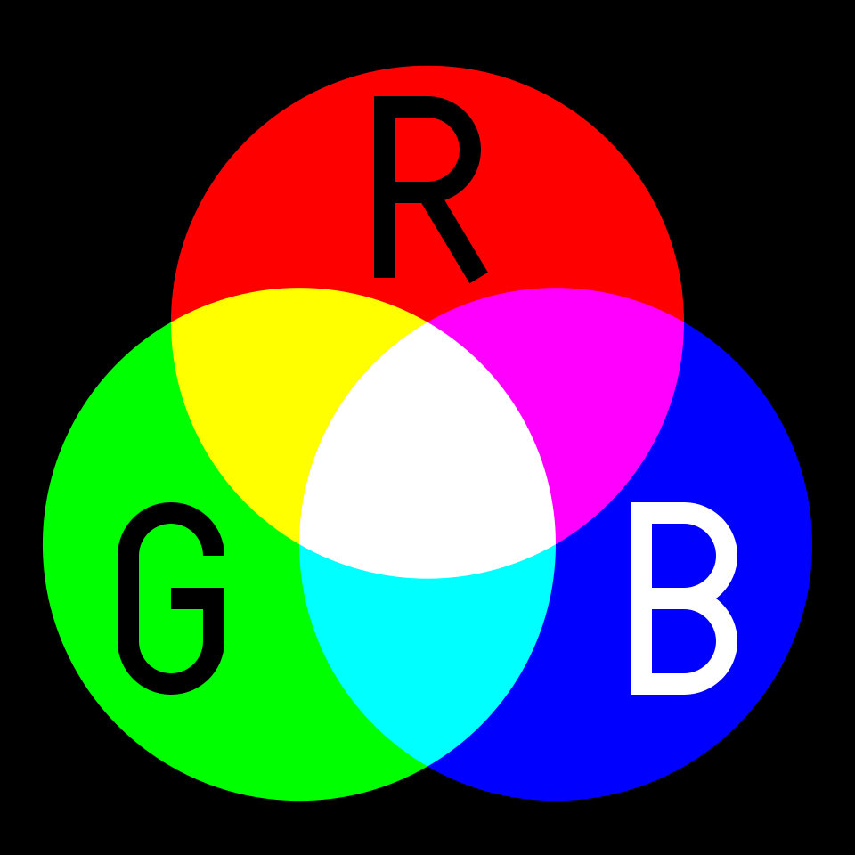
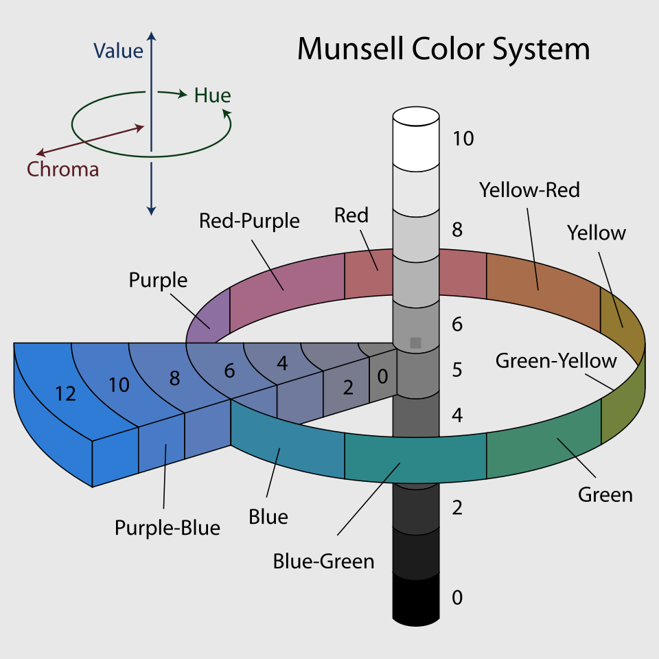

# Chapitre 9 — Couleur et contraste

*Figure 9.1 — Synthèse additive (écrans). Wikimedia Commons (domaine public).*

## 9.1 Bases de la théorie des couleurs

- **Synthèse additive** (écrans : rouge, vert, bleu — RVB) et **synthèse soustractive**
  (pigments) sont les deux grands modèles de mélange [S52].
- Plusieurs systèmes de description : le cercle chromatique de Goethe (1810), le système de
  Munsell (1905) qui décrit les couleurs par trois variables (teinte, valeur, saturation) [S52].
- En interface, on raisonne en **teinte** (la couleur « pure »), **saturation** (intensité) et
  **valeur/luminosité** (clair-foncé) ; c'est la **valeur** qui porte le contraste de lecture.

*Figure 9.2 — Système de Munsell (1905). Wikimedia Commons (CC BY-SA 3.0).*

## 9.2 Le rôle de la couleur dans la hiérarchie

Voir chapitre 7 : la hiérarchie vient du **contraste** de valeur et de saturation, pas de la
couleur en soi ; 2 primaires + 2 secondaires maximum ; réserver les couleurs chaudes vives
(rouge) aux alertes et erreurs [S34].

## 9.3 Contraste : les seuils WCAG

Critère 1.4.3 *Contraste (minimum)*, niveau AA [S45] :

| Contenu | Ratio minimal |
|---|---|
| Texte normal et images de texte | **4,5 : 1** |
| Texte **large** (≥ 18 pt, ou ≥ 14 pt gras ; ≈ 24 px, ≈ 18,5 px gras) | **3 : 1** |
| Texte inactif, décoratif, logotypes | aucune exigence |

Détails importants [S45] :

- les seuils sont des **valeurs seuils non arrondies** (4,499 : 1 ne passe pas) ;
- s'applique aussi au **texte de substitution (placeholder)**, aux textes d'infobulle et au
  texte affiché au focus ;
- 1 pt = 1,333 px ;
- les polices **très fines ou inhabituelles** peuvent rendre plus pâles à cause de l'anticrénelage :
  viser un contraste supérieur au minimum ;
- les logos sont exemptés, mais pas le texte « de marque » hors logotype ;
- le calcul est fait pour que la **teinte ne soit pas un facteur** : seul compte le contraste de
  luminance relative.

Niveau AAA (critère 1.4.6) : 7 : 1 [S47]. web.dev précise que 4,5 : 1 compense une perte de
sensibilité au contraste équivalente à environ une acuité de 20/40 [S47].

### La formule

Le ratio de contraste vaut `(L1 + 0,05) / (L2 + 0,05)` où L1 est la luminance relative de la
couleur la plus claire et L2 celle de la plus sombre ; pour le sRGB,
`L = 0,2126 × R + 0,7152 × G + 0,0722 × B` (R, G, B étant les composantes linéarisées) [S46].
Le vert pèse le plus car l'œil y est le plus sensible.

### Contraste des éléments non textuels

Critère 1.4.11 *Contraste des éléments non textuels* (AA) : bordures de champs, icônes, états
de composants, parties de graphiques doivent atteindre **3 : 1** contre leur voisinage (détail
au chapitre 14).

### Autres approches

web.dev [S47] présente **APCA** (Advanced Perceptual Contrast Algorithm), qui calcule le
contraste selon la taille/graisse du texte, la différence de luminosité perçue et le contexte ;
Chrome propose une fonction expérimentale pour remplacer les seuils AA/AAA par APCA. Les
exigences réglementaires restent celles de WCAG.

## 9.4 Ne jamais coder l'information par la couleur seule

Critère 1.4.1 *Utilisation de la couleur* (A) [S48] : la couleur ne doit pas être le **seul**
moyen visuel de transmettre une information, indiquer une action, solliciter une réponse ou
distinguer un élément. Exemples d'infraction : « les champs obligatoires sont en rouge »,
« l'erreur est en rouge », « les ventes de Marie en rouge, celles de Tom en bleu ». Ne
décourage pas la couleur ni le codage couleur, **s'il est complété** (forme, texte, icône,
motif).

web.dev [S47] illustre : un champ invalide souligné en rouge ne dit rien au lecteur d'écran ni
à l'utilisateur daltonien ; ajouter un message d'erreur et un texte d'aide, tout en gardant le
soulignement rouge.

## 9.5 Daltonisme et déficiences de la vision des couleurs

- Environ **1 homme sur 12 (8 %)** et **1 femme sur 200 (0,5 %)** (population d'origine nord-
  européenne) présentent un daltonisme rouge-vert [S51].
- Types : protanopie/protanomalie (rouge), deutéranopie/deutéranomalie (vert), tritanopie
  (bleu, rare), achromatopsie [S51].
- **Règle de conception** : doubler toute distinction de teinte par une distinction de valeur
  (clair/foncé), de forme ou de libellé. Tester avec un simulateur (voir chap. 18) ou en
  niveaux de gris.
- Rappel [S45] : les personnes avec une déficience des couleurs perçoivent normalement le
  contraste clair-foncé — d'où le choix du calcul par luminance.

*Figure 9.3 — Simulation d'une vision deutéranope. Wikimedia Commons (CC BY-SA 4.0).*

*Figure 9.4 — Simulation d'une vision protanope. Wikimedia Commons (CC BY-SA 4.0).*

## 9.6 Couleurs fonctionnelles : l'exemple GOV.UK

Le design system du gouvernement britannique définit des **couleurs fonctionnelles** par
usage, plutôt que des valeurs hexadécimales à recopier [S49] :

| Rôle | Valeur |
|---|---|
| Texte | `#0b0c0c` |
| Texte secondaire | `#484949` |
| Lien / survol / visité | `#1a65a6` / `#0f385c` / `#54319f` |
| Bordure de champ | `#0b0c0c` |
| Focus | `#ffdd00` (jaune, **réservé** au focus clavier) |
| Erreur | `#ca3535` |
| Succès | `#0f7a52` |
| Marque | `#1d70b8` |

Enseignements transposables : **un rôle = une couleur** ; la couleur de focus n'est utilisée
que pour le focus ; chaque rôle respecte le contraste AA ; la palette générale se décline en
teintes (tints) et ombres (shades) à 25/50/80/95 % [S49].

## 9.7 Mode sombre

NN/g (Raluca Budiu, 2020) [S50] — note : NN/g n'a pas mené sa propre recherche, il s'agit
d'une revue de littérature.

- **Polarité positive** = texte sombre sur fond clair ; **négative** = texte clair sur fond
  sombre.
- Études récentes (2013 *Ergonomics*, 2017 *Applied Ergonomics*) : chez les personnes à vision
  normale, le **mode clair** donne de meilleurs résultats la plupart du temps (acuité,
  relecture), notamment car la pupille se contracte davantage, ce qui réduit les aberrations
  et augmente la profondeur de champ.
- Certaines personnes (ex. cataracte) peuvent mieux lire en mode sombre ; les écrans sombres
  émettent moins de lumière et peuvent économiser la batterie.
- **Recommandation** : ne pas imposer le mode sombre par défaut au grand public, mais
  **permettre de l'activer** — surtout pour les applications de lecture longue — de façon
  **cohérente sur tous les écrans**, en utilisant l'API système s'il en existe une.

> **Règle projet.** Respecter le thème système (clair/sombre) et vérifier les contrastes
> **dans les deux thèmes** : un contraste valide en clair peut échouer en sombre.

## 9.8 Checklist couleur

- [ ] Texte normal ≥ 4,5 : 1 ; texte large ≥ 3 : 1 ; éléments d'interface ≥ 3 : 1.
- [ ] Aucune information portée par la couleur seule.
- [ ] Rôles de couleurs nommés (primaire, erreur, succès, avertissement, neutre).
- [ ] Rouge/orange réservés aux alertes ; couleur de focus dédiée.
- [ ] Palette limitée (2 primaires + 2 secondaires).
- [ ] Testé en niveaux de gris, en mode sombre, en plein soleil (luminosité maximale).

---
*Sources du chapitre : S34, S45–S52.*
