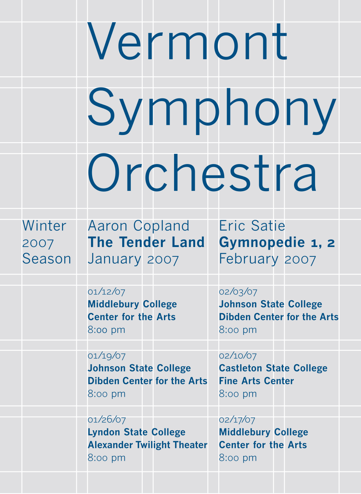

# Chapitre 10 — Mise en page, grilles, espacement et adaptation aux écrans

*Figure 10.1 — Grille de mise en page : le contenu n'appartient pas à la grille, il s'y applique.
Wikimedia Commons. Voir `images/CREDITS.md`.*

## 10.1 La grille en design graphique

Une grille est une structure (généralement bidimensionnelle) de lignes qui sert d'**armature**
pour organiser les éléments graphiques de façon rationnelle et facile à absorber ; elle permet
de situer les éléments par rapport à la page, entre eux, ou par rapport à d'autres parties d'un
même élément [S59].

Histoire [S59] : avant l'imprimerie, des systèmes de proportions optimales (diagramme de
Villard, médiéval) organisaient les pages manuscrites ; après la Seconde Guerre mondiale, Max
Bill, Emil Ruder et Josef Müller-Brockmann, nourris des idées de Jan Tschichold (*Die neue
Typographie*), conçoivent une grille flexible qui donne naissance au **style typographique
international**. L'ouvrage de référence : *Grid Systems in Graphic Design* (Müller-Brockmann).

## 10.2 Principes de mise en page applicables

| Principe | Explication | Source |
|---|---|---|
| **Concevoir « petit écran d'abord »** | Commencer par une seule colonne, enrichir pour les grands écrans | [S54] |
| **Limiter la longueur des lignes** | Pas plus d'environ **75 caractères par ligne** : le GOV.UK recommande des colonnes « deux tiers » ou « deux tiers + un tiers » | [S54] |
| **Largeur maximale de page** | 1020 px par défaut au GOV.UK, extensible si le contenu l'exige | [S54] |
| **Ne pas supposer l'appareil** | Concevoir pour des *tailles d'écran*, pas pour des modèles d'appareils | [S54] |
| **Un contenu principal** | Le contenu principal reste dans la colonne des deux tiers, même sans colonne secondaire | [S54] |

## 10.3 L'échelle d'espacement

Le design system GOV.UK définit deux échelles [S53] :

- **échelle adaptative** : les valeurs d'espacement augmentent au-delà du point de rupture
  « tablette » (**640 px**) ; les plus petites unités (0 à 3) ne changent pas ;
- **échelle statique** : mêmes valeurs sur tous les écrans (celles des « grands écrans »).

Valeurs de l'échelle statique (px) [S53] : **10, 15, 20, 25, 30, 40, 50, 60** (exemples donnés
par la source : unité 6 = 30 px ; unité 9 = 60 px ; unité 5 = 25 px ; unité 3 = 15 px). Des classes
de dérogation (`govuk-!-margin-…`) permettent des ajustements mineurs ; on peut aussi utiliser
des valeurs négatives.

**Principe retenu :** un **petit jeu de valeurs d'espacement réutilisées** (échelle à pas
régulier, par exemple multiples de 4 ou 8) plutôt que des marges arbitraires. Cela produit le
rythme visuel et rend la proximité (chap. 7) prévisible : espace *interne* d'un groupe < espace
*entre* groupes.

## 10.4 Le design adaptatif sur Android

### Classes de taille de fenêtre (window size classes) [S55]

| Classe | Largeur | Représente |
|---|---|---|
| **Compact** | < 600 dp | 99,96 % des téléphones en portrait |
| **Medium** | 600 – 839 dp | 93,73 % des tablettes en portrait, grands écrans pliables dépliés en portrait |
| **Expanded** | 840 – 1199 dp | 97,22 % des tablettes en paysage |
| **Large** | 1200 – 1599 dp | Grandes tablettes |
| **Extra-large** | ≥ 1600 dp | Écrans de bureau |

Hauteurs : compact < 480 dp (99,78 % des téléphones en paysage) ; medium 480 – 899 dp ; expanded
≥ 900 dp [S55].

Points clés [S55][S56] :

- Les classes sont déterminées par la **fenêtre disponible pour l'app**, **pas par l'appareil** :
  pas de logique « isTablet ». Écran partagé, fenêtres redimensionnables (ChromeOS), pliables :
  la classe **change pendant la vie de l'app** et l'interface doit s'adapter.
- La **largeur** est généralement le critère principal (le défilement vertical est la norme) ;
  considérer aussi la **hauteur** (téléphone en paysage : largeur medium mais hauteur compacte →
  pas de deux volets).
- Une app adaptative **remplace des composants** et **montre/masque du contenu**, au lieu de
  seulement étirer ou rétrécir : barre de navigation inférieure sur téléphone, **rail de
  navigation** sur grand écran ; vue **liste-détail** à deux volets sur grand écran, un seul
  volet (liste *ou* détail) sur petit écran [S56].
- En Compose : `currentWindowAdaptiveInfo()` (bibliothèque `androidx.compose.material3.adaptive`)
  fournit le `windowSizeClass`, et l'on passe cet état aux composables imbriqués [S55].
- **Tester** à toutes les classes ; optimiser d'abord la classe *expanded* si l'on part d'une
  mise en page compacte, puis décider de la classe *medium* [S55].
- Prendre en charge d'autres **entrées que le toucher** (clavier, souris) [S56].

## 10.5 Le design responsive sur le web

Défini par Ethan Marcotte (A List Apart) : une stratégie qui répond aux besoins des utilisateurs
et aux capacités de leurs appareils en changeant la mise en page [S57]. Trois techniques
fondatrices [S58] : **grilles fluides** (unités relatives), **images flexibles**, **requêtes de
média** (CSS3 `@media`).

Recommandations de web.dev [S57] :

1. **Balise viewport** : `<meta name="viewport" content="width=device-width, initial-scale=1">`.
   Sans elle, les navigateurs mobiles rendent la page à ~980 px puis réduisent. **Ne pas utiliser**
   `minimum-scale`, `maximum-scale` ou `user-scalable` : ils empêchent le zoom (accessibilité).
2. **Dimensionner le contenu au viewport** : on défile verticalement, pas horizontalement.
3. **Images** : `max-width: 100%` ; **toujours indiquer `width` et `height`** pour réserver
   l'espace avant chargement (évite les décalages de mise en page — voir chap. 15).
4. **Mise en page** : éviter les pixels fixes ; utiliser Flexbox (éléments de tailles
   différentes sur une ou plusieurs lignes), CSS Grid (grilles flexibles, unité `fr`) et
   multicol.

## 10.6 Orientation, plis et zones de pouce (mobile)

Voir chapitre 12 (zone d'atteinte du pouce, gestes).

## 10.7 Check-list de mise en page

- [ ] Une colonne sur petit écran ; contenus principaux en haut.
- [ ] Longueur de ligne ≤ ~75 caractères.
- [ ] Échelle d'espacement unique, appliquée partout.
- [ ] Marges internes d'un groupe < marges entre groupes.
- [ ] Aucun défilement horizontal ; zoom autorisé.
- [ ] Testé en paysage, avec police agrandie, en écran partagé.
- [ ] Images/zones avec dimensions réservées.

---
*Sources du chapitre : S53–S59.*
