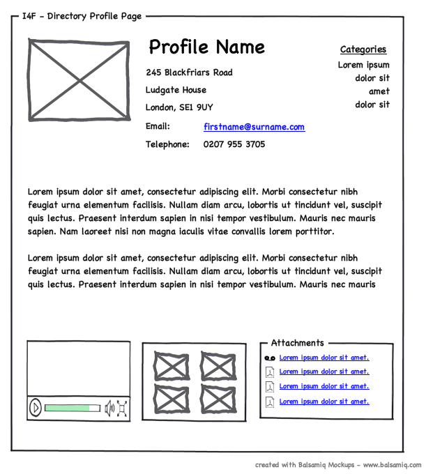

# Chapitre 18 — Esquisser, prototyper, évaluer

> Dessiner coûte moins cher que coder, et coder une mauvaise idée coûte plus cher que tout.
> Ce chapitre suit le fil : **esquisse → wireframe → prototype → évaluation**, avec les
> méthodes d'évaluation complémentaires du chapitre 4.

*Figure 18.1 — Un wireframe : structure et fonctions, pas le style. Wikimedia Commons, voir `images/CREDITS.md`.*

## 18.1 Les wireframes (IxDF) [S123]

Un wireframe est une représentation **simple** de la structure d'un écran : il répond à « **quoi
va où** » et « **comment ça marche** », sans prétendre être le design final.

- **Niveau de détail** : assez pour transmettre structure, mise en page et fonctionnalité **sans
  ralentir l'itération** ni figer trop tôt les décisions. Tôt : **basse fidélité** (formes simples
  et marqueurs de place) pour se concentrer sur **l'usage et la hiérarchie** ; ensuite : libellés,
  positions des boutons, contenu d'exemple.
- **Place dans le flux de travail** : **après** le recueil des besoins, **avant** le visuel
  détaillé ; il traduit la recherche en dispositions concrètes, puis évolue en **maquette**
  (mockup) et en **prototype**.
- **Éléments d'un bon wireframe** : une **grille** ; des **marqueurs** pour titres, textes,
  images, boutons ; navigation, recherche et appels à l'action **clairement indiqués** ; des
  **annotations** pour les comportements (menus déroulants, modales) ; **monochrome et sobre**.
- **Erreurs fréquentes** : trop de détails visuels (couleurs, images, marque) ; **oublier le
  flux** (un wireframe n'est pas qu'un écran statique) ; symboles incohérents ou libellés
  absents ; **ne pas tester tôt**.

## 18.2 Les prototypes : cinq méthodes de basse fidélité (IxDF) [S124]

| Méthode | Principe | Meilleur usage |
|---|---|---|
| **Croquis** | Faciles à faire et à jeter (techniquement pas des prototypes) | Phases **divergentes** : explorer des idées, communiquer |
| **Prototype papier** | « Animations » grossières en faisant glisser des feuilles | Tester des **solutions nouvelles** et des flux ; moins utile pour des motifs d'interface **standard** |
| **Prototype en Lego** | Briques pour des maquettes physiques | Empathie, parcours, systèmes complexes |
| **Wireframes numériques** | Squelette de mise en page et de fonctionnalité | **Après** l'idéation : architecture, mise en page, espace |
| **Magicien d'Oz** | Un humain simule en coulisses une fonction complexe | Systèmes complexes, technologies futures, **interfaces vocales** |

Principe général de [S2] : **moins on investit dans l'idée, mieux c'est** — il faudra la changer
selon les tests ; affiner ensuite par **itérations** de la basse à la haute fidélité, en testant à
chaque fois.

## 18.3 Évaluation : méthodes complémentaires

### Think-aloud — la méthode n°1 (Nielsen) [S122]
On demande aux participants d'utiliser le système en **pensant à voix haute**. Trois choses
suffisent : recruter des utilisateurs représentatifs, leur donner des tâches représentatives,
**se taire** et les laisser parler. Avantages :

- **Fenêtre sur ce qu'ils pensent vraiment** : on entend les **idées fausses**, qui se traduisent
  en recommandations de refonte ;
- **Peu coûteuse** : un jour pour quelques utilisateurs ;
- **Robuste** : même mal menée, elle donne de bons résultats tant qu'on ne met pas les mots dans la
  bouche du participant (les études quantitatives, elles, sont fragiles et chères) ;
- **Flexible** : à tout stade (du prototype papier au système réel), adaptée à l'Agile ;
- **Convaincante** : voir des clients penser ramollit les sceptiques ;
- **Facile à apprendre**.
Limite : pas de statistiques détaillées sans grosse étude ; garder le rôle de facilitateur
prudent (inviter à parler, ne pas guider). Nielsen : cette méthode est la n°1 depuis 1993.

### Contextual inquiry — observer en contexte (NN/g) [S118]
Étude de terrain ethnographique : **observation et entretiens approfondis** d'un petit échantillon
d'utilisateurs **dans leur environnement naturel** (« contexte ») en leur posant des questions
sur le pourquoi et le comment (« enquête »). Conçue par Hugh Beyer et Karen Holtzblatt pour
corriger les limites des sondages et entretiens, qui reposent sur la capacité à *se rappeler et
expliquer* un processus. Valeur : on voit ce qu'on n'attendait pas — **interruptions,
comportements superstitieux, processus illogiques**, détails devenus invisibles.

Exemple de NN/g : en observant des spécialistes saisir des données d'assurance, la chercheuse a
découvert des étapes non mentionnées en entretien (consultation d'un autre outil, et clic
habituel sur « Enregistrer » après chaque saisie malgré l'enregistrement automatique : ils
ne savaient pas ou ne croyaient pas qu'il y avait sauvegarde). **Utile en début de projet**, pour les
systèmes complexes et les experts ; **peu utile** pour une tâche ciblée (page produit,
formulaire d'inscription).

### Études par journal (diary studies) [S119]
Méthode qualitative : les participants consignent leurs activités **au fil de l'eau** sur plusieurs
jours, semaines ou un mois. Elle capte les comportements **dans le temps et en contexte**, **à
distance et de façon asynchrone** (moins cher que le terrain). Questions types : habitudes et
fréquence, attitudes et motivations, évolution des comportements (apprenabilité, fidélité),
parcours client, usage de canaux et d'appareils, facteurs externes (collaborations, concurrents,
outils tiers). À préférer à un test d'usabilité ou à un entretien ponctuels, qui sortent l'usager de
son contexte.

### Cognitive walkthrough — apprenabilité sans utilisateurs [S120]
Technique d'inspection **par tâches** pour évaluer l'**apprenabilité** du point de vue d'un
**nouvel** utilisateur, sans le recruter. Atelier avec une équipe pluridisciplinaire (UX, produit,
ingénieurs, experts métier) : un facilitateur exécute la tâche, **s'arrête à chaque écran** ; les
évaluateurs répondent à **quatre questions** :

1. **L'utilisateur essaiera-t-il d'obtenir le bon résultat ?** (comprend-il que cette étape est
   nécessaire ?)
2. **Remarquera-t-il que la bonne action est disponible ?** (visible, trouvable ?)
3. **Associera-t-il la bonne action au résultat visé ?** (libellé compris ?)
4. **Après l'action, verra-t-il qu'il progresse ?** (feedback)

Un rapporteur note les réponses et la probabilité de réussite/échec. Utile pour les interfaces
**complexes et nouvelles**.

### Formative vs sommative [S121]
| | Formative | Sommative |
|---|---|---|
| But | Savoir ce qui marche ou non, et pourquoi, pour **améliorer** | Mesurer **la performance** d'un produit fini, par rapport à une référence (version précédente, concurrent) |
| Fréquence | Tout au long de la conception, **souvent**, quelques utilisateurs | Moins souvent : **juste avant ou après** une refonte |
| Exemple | Tester un prototype d'onboarding avec 5 utilisateurs | Temps de tâche et taux de réussite des fonctions clés vs version précédente |

Termes forgés par Michael Scriven (1967). La **décision de livrer** (go/no-go) est l'évaluation
sommative ultime ; il est rare que des entreprises aient un processus formel pour **tuer un
mauvais design** [S121].

## 18.4 Un plan d'évaluation minimal pour une petite app

1. **Avant de dessiner** : observer 2-3 utilisateurs sur le terrain (contextual inquiry léger) [S118].
2. **Croquis papier** de l'écran critique ; test **think-aloud** avec 3 à 5 personnes [S122][S8].
3. **Wireframes** des écrans ; **cognitive walkthrough** à deux (quatre questions par étape) [S120].
4. **Prototype** (ou version minimale) ; second tour de 5 personnes [S8].
5. **Après livraison** : évaluation sommative légère (temps de tâche, taux de réussite, SUS)
   par rapport à la version précédente [S121][S13].
6. **Tout noter** : décisions, résultats, versions.

---
*Sources du chapitre : S2, S8, S13, S118–S124.*
