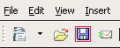

# Chapitre 21 — Icônes, styles visuels et principes du « bon design »

*Figure 21.1 — La disquette de l'icône « Enregistrer » : une métaphore qui survit à son objet.
Wikimedia Commons. Voir `images/CREDITS.md`.*

## 21.1 Les icônes (NN/g) [S147][S148]

Une icône est la représentation visuelle d'un objet, d'une action ou d'une idée. Si ce n'est pas
immédiatement clair, elle devient du « bonbon pour les yeux » — du **bruit visuel** qui gêne la
tâche [S147].

### Avantages [S147]
- **Bonnes cibles** : assez grandes pour le doigt (alors que les mots souffrent de l'asymétrie
  lecture-toucher) ; elles **économisent de l'espace** ;
- **Reconnues d'un coup d'œil** (surtout les icônes standard) ;
- **Pas de traduction** nécessaire (mais attention aux différences culturelles : une enveloppe est
  plus internationale qu'une boîte aux lettres) ;
- esthétique, appartenance à une **famille de produits**.

### Les icônes « universelles » sont rares [S147]
Reconnues quasi universellement : **accueil, imprimer, loupe (recherche)**. Les autres sont
**ambiguës** : le **hamburger** (menu principal ou liste ?), le **cœur** et l'**étoile**
(favoris, signets, notes — avec des fonctions variables d'un site à l'autre). Même une légère
différence de sens nuit à la mémorisation.

### Règles [S147]
1. **Toute icône a un libellé visible en permanence**, sans interaction ; « ne pas compter sur le
   survol » (coût d'interaction, absent au toucher). Pour la **navigation**, c'est critique.
2. Si l'on peine à trouver une icône pour une rubrique, c'est qu'elle ne sera pas reconnaissable.
3. **Taille relative** : une icône sur mobile (≈ 20–25 % de la largeur) est bien plus saillante que
   la même sur un grand écran riche en contenu ; ne pas supposer que ce qui marche sur mobile marche
   sur desktop.
4. Un libellé même pour une icône standard légèrement modifiée.

### Tester les icônes [S148]
Quatre critères de qualité : **trouvabilité** (la trouve-t-on sur la page ?), **reconnaissance**
(comprend-on ce qu'elle représente ?), **odeur de l'information** (devine-t-on ce qui se passera ?),
**attrait**.

| Critère | Méthode | Contexte |
|---|---|---|
| **Trouvabilité** | Test de **temps de localisation** + taux de **premier clic** correct | **En contexte** (interface complète) |
| **Reconnaissance** | L'icône montrée **seule, sans libellé** : « que représente-t-elle ? » (le « test de Rorschach des icônes ») ; si les réponses sont hors sujet, **abandonner** l'idée | **Hors contexte** |
| **Odeur de l'information** | Même méthode : « que vous attendez-vous à voir se produire si vous la touchez ? » | Hors contexte |

Remarque : tant que la fonction est comprise, peu importe qu'on sache ce qu'est l'objet (la
disquette « Enregistrer » est comprise par ceux qui n'en ont jamais vu) [S148]. Les participants
doivent appartenir au public visé.

## 21.2 Skeuomorphisme, réalisme, flat, flat 2.0 (NN/g) [S150][S149]

| Style | Définition | Effet |
|---|---|---|
| **Effets 3D** | Illusion de profondeur : ce qui est **en relief** paraît cliquable, ce qui est **en creux** paraît remplissable | Signifiants utiles, mais les premiers GUI (Windows 95) en abusaient |
| **Skeuomorphisme** | Objet avec des **éléments ornementaux inutiles** imitant un précédent réel, pour aider à comprendre (étagère à bois de la Kindle Fire) | Aide la métaphore ; amazon l'a abandonnée |
| **Réalisme** | Imiter des textures physiques **pour l'esthétique** (pas de métaphore) | Souvent confondu avec le skeuomorphisme |
| **Flat design** | Absence d'effets brillants ou 3D ; popularisé vers **2012** (Microsoft Metro / Windows 8, 2011, « authentiquement numérique ») ; Apple l'adopte vers 2013 | Défaut majeur : **perte des signifiants** → **incertitude du clic** |
| **Flat 2.0 / semi-flat** | Flat avec **ombres, reliefs et couches subtiles** | Recommandé pour la plupart des produits |

### Quand un flat total peut convenir [S149]
Peu de contenu et architecture simple (1 à 10 pages) ; peu d'interactivité ; **beaucoup de
visiteurs récurrents** ; utilisateurs experts. Même alors, NN/g déconseille un flat total dans la
plupart des cas (acceptable : portfolios, sites vitrines simples).

### Stratégies contre l'incertitude du clic [S149]
- **Ne jamais** donner le même traitement visuel au texte statique et au texte lié.
- Les boutons doivent **ressembler un peu à des boutons** ; **éviter les « boutons fantômes »**
  (texte avec fin contour) ; icônes standard **avec libellés**.
- **Mises en page et motifs standard** : la disposition attendue compense l'absence de signifiants.
- **Contraste** : le gris clair sur gris foncé « fonctionne rarement » ; prudence avec les images
  derrière le texte.
- **Rajouter de la profondeur** (ombres, couches subtiles) : Material Design a tenté un cadre
  rigoureux, mais les ombres sont parfois utilisées pour l'esthétique plutôt que pour appuyer le
  modèle mental.

## 21.3 Les styles récents (d'après Wikipédia) [S151][S152]

| Style | Caractéristiques | Origine | Réserve |
|---|---|---|---|
| **Neumorphisme** | Doux et clair ; éléments de la **même couleur que le fond**, distingués seulement par ombres et reflets (en relief ou en creux) ; couleurs pastel à **faible contraste** | Terme de Jason Kelly, 2019 ; exemple de Alexander Plyuto | Le faible contraste pose un problème d'accessibilité (chap. 9, 14) ; milieu entre skeuomorphisme et flat |
| **Glassmorphisme** | Couleurs vives couvertes de **couches vitreuses** : panneaux semi-transparents, flou d'arrière-plan, bords arrondis, contour fin ; plus la transparence est grande, plus l'élément paraît proche | Terme de Michal Malewicz, 2020 ; Apple macOS Big Sur (2020) | Texte sur fond flou et mobile : vérifier le contraste |

Selon la page Wikipédia, le glassmorphisme a progressivement remplacé le flat dans les années 2020,
avec **Liquid Glass** d'Apple (iOS 26, 2025) et des évolutions de One UI, HarmonyOS et Android [S152].
*(À considérer comme un état de l'art daté : les sources de cette section sont des articles
encyclopédiques, non des études d'usabilité.)*

> **Règle pratique.** Une tendance visuelle ne dispense jamais de **signifiants clairs, de
> contraste suffisant (≥ 4,5 : 1 / 3 : 1) et de cibles lisibles** (chap. 9, 12, 14). Quand le style
> gêne la lisibilité, le style perd.

## 21.4 Les dix principes de Dieter Rams [S153]

Vers la fin des années 1970, Rams, inquiet de « une confusion impénétrable de formes, de couleurs
et de bruits », se demanda si son propre design était un bon design. Sa réponse :

| N° | Principe | Lecture pour une interface |
|---|---|---|
| 1 | **Innovant** | L'innovation avance avec la technologie, elle n'est pas une fin |
| 2 | **Rend le produit utile** | Éliminer tout ce qui nuit à l'utilité |
| 3 | **Esthétique** | La qualité esthétique fait partie de l'utilité (effet esthétique-usabilité) |
| 4 | **Rend le produit compréhensible** | Au mieux, il s'explique de lui-même |
| 5 | **Discret** (unobtrusive) | Un outil, non une œuvre d'art : neutre et sobre, laisse la place à l'utilisateur |
| 6 | **Honnête** | N'exagère pas la valeur du produit, ne manipule pas par de fausses promesses (cf. motifs trompeurs, chap. 22) |
| 7 | **Durable** | Évite la mode |
| 8 | **Soigné jusque dans le moindre détail** | Rien d'arbitraire ; la précision témoigne du respect de l'utilisateur |
| 9 | **Respectueux de l'environnement** | Économiser les ressources (batterie, données) |
| 10 | **Aussi peu de design que possible** | Concentré sur l'essentiel : « moins, mais mieux » |

*(Les huit premiers intitulés détaillés proviennent de la page de Vitsœ [S153] ; les deux derniers
figurent dans la suite du même texte, dont la page lue ici a été tronquée par l'extraction :
principes 9 et 10 repris de la formulation standard de Rams.)*

## 21.5 Check-list
- [ ] Chaque icône non universelle a un libellé visible.
- [ ] Icônes testées (reconnaissance hors contexte, trouvabilité en contexte).
- [ ] Les éléments cliquables se distinguent des éléments statiques.
- [ ] Style visuel (flat, glass…) sans perte de contraste ni de signifiants.
- [ ] Rien de décoratif qui ne serve la tâche.

---
*Sources du chapitre : S147–S153.*
