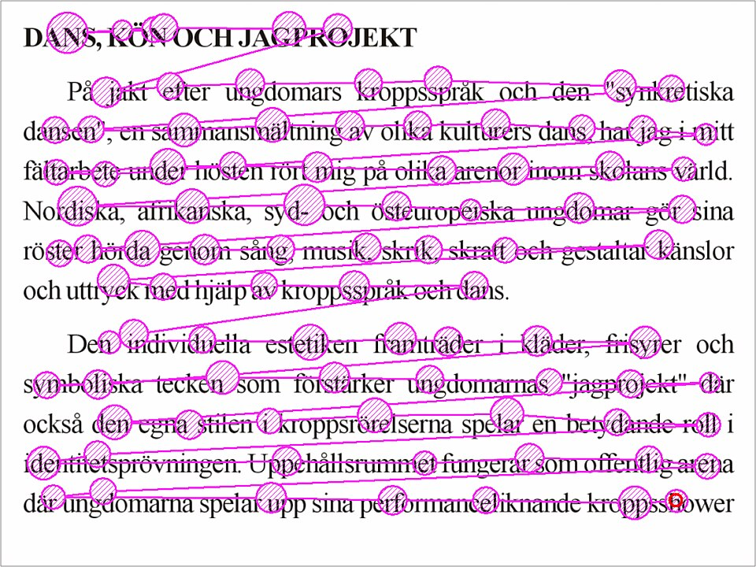

# Chapitre 30 — Attention, regard et charge cognitive

*Figure 30.1 — Fixations et saccades pendant la lecture : les yeux ne glissent jamais
régulièrement sur un texte immobile. Wikimedia Commons. Voir `images/CREDITS.md`.*

## 30.1 Ce que révèle le suivi du regard (eye tracking) [S182]

### Histoire
- **1879** : Louis Émile Javal observe que la lecture n'est pas un balayage régulier mais une suite
  d'**arrêts courts (fixations)** et de **mouvements rapides (saccades)**.
- Edmund Huey construit un des premiers oculomètres (lentille avec pointeur) ; il montre que **tous
  les mots d'une phrase ne sont pas fixés** et que seule une petite part des saccades sont des
  **régressions**.
- **Guy Thomas Buswell** : premiers oculomètres non intrusifs (faisceaux lumineux réfléchis).
- **Alfred Yarbus** (années 1950, livre de 1967) : **la tâche donnée au sujet a une très grande
  influence sur ses mouvements oculaires** ; l'attention est souvent attirée par des éléments
  **inhabituels, peu familiers, incompréhensibles** ou qui semblent informatifs sans l'être ; l'œil
  **revient** aux éléments les plus importants.
- **1980** : *hypothèse forte œil-esprit* de Just et Carpenter (« pas de décalage appréciable entre ce
  qui est fixé et ce qui est traité »), souvent tenue pour acquise mais **contestée** par l'attention
  **couverte** (on peut prêter attention à ce qu'on ne regarde pas) : une fixation **n'indique pas
  directement** un processus cognitif (reconnaissance, intérêt, perplexité…) ; on associe donc
  souvent l'eye tracking à d'autres méthodes (protocoles verbaux).
- Années 1980 : premières études d'IHM (recherche de commandes dans les menus) ; aujourd'hui :
  réactions aux menus déroulants, placement des publicités ; **IA/réseaux de neurones** pour
  l'analyse des données.
- Consensus actuel (Hoffman) : l'attention visuelle devance l'œil de **100 à 250 ms**.

### Types d'appareils
Mesure de l'**objet attaché à l'œil** (lentille), suivi **optique sans contact**, mesure des
**potentiels électriques** (électrodes autour des yeux). Les oculomètres portables sont de plus en
plus utilisés dans la vie quotidienne [S182].

### Que faire de ces connaissances ?
1. **La tâche détermine le regard** : concevoir pour la **tâche**, pas pour une « jolie page ».
2. **Les éléments inhabituels attirent l'œil** (effet Von Restorff, chap. 6) : à utiliser avec retenue.
3. Un regard n'est **pas** une compréhension : **tester** avec des protocoles verbaux (think-aloud,
   chap. 18).
4. Les **parcours de lecture** (F, couche, tache…) du chapitre 7 viennent de ces études.

## 30.2 La cécité aux bannières (NN/g, 2018) [S183]

Tendance à **ignorer** les éléments perçus (à tort ou à raison) comme des **publicités**. C'est une
instance de l'**attention sélective** : on dirige l'attention sur un sous-ensemble de stimuli — ceux
liés à nos buts ; sinon on serait submergé. Aujourd'hui encore, elle est **bien présente**, sur
mobile comme sur ordinateur.

**Trois traits qui signalent une publicité** :
1. **Placement spécifique** : haut de page, colonne de droite (les internautes ont appris à ignorer
   même les annonces du haut des résultats Google) ;
2. **Traitement visuel de pub** : animation, petit rectangle au milieu du texte, formatage
   sophistiqué, fond coloré (bleu sur page blanche), texte dans l'image ;
3. **Proximité d'annonces** : un contenu placé près d'une pub est **souvent pris pour une pub et
   ignoré** — conséquence directe de la **loi de proximité** (chap. 7 et 29). Les publicités
   « empoisonnent » les éléments voisins.

Exemple chiffré : 26 participants sur une page avec bandeau haut et colonne droite ont **lu le texte
et très peu regardé les annonces**.

> **Application aux apps.** Ne pas styliser un contenu important comme une promo (fond bleu en
> bandeau, texte dans une image) ; ne pas le placer là où l'on place d'ordinaire les pubs ; ne pas
> le coller à une zone publicitaire.

## 30.3 La charge cognitive [S184]

La **charge cognitive** est l'**effort utilisé dans la mémoire de travail**. Trois types, issus de la
conception pédagogique :

| Type | Définition |
|---|---|
| **Intrinsèque** | Difficulté inhérente à un sujet (2 + 2 vs une équation différentielle) ; ne peut pas être modifiée par l'enseignant, mais on peut **découper en sous-schémas** |
| **Extrinsèque** | Liée à **la façon dont l'information ou la tâche est présentée** |
| **Germane** (productive) | Ressources que l'apprenant consacre à gérer la charge intrinsèque et à construire un **schéma** (stock permanent de connaissances) |

Les trois s'influencent mutuellement plutôt que de s'additionner simplement.

- **Théorie de la charge cognitive** : développée par **John Sweller** à la fin des années 1980, en
  étudiant la résolution de problèmes ; elle prolonge **Miller (1956)**. Postulat : **la qualité de la
  conception s'améliore si l'on tient compte des limites de la mémoire de travail**, extrêmement
  limitée en capacité et en durée.
- **Chunk** : terme introduit par **Simon et Chase (1973)** pour décrire l'organisation de
  l'information en mémoire à court terme.
- **Effets** démontrés dans les années 1990 : *effet de complétion*, *modalité*, *attention
  partagée* (split-attention), *exemple résolu*, *inversion de l'expertise*.
- Mesure : effort mental perçu ; **réponse pupillaire** liée à la tâche (méthode sensible et fiable).
- La charge vécue **n'est pas la même chez tous** : plus élevée pour les enfants, les étudiants, les
  personnes âgées ; les distractions numériques l'augmentent.

### Principes de conception qui en découlent
| Principe | Application |
|---|---|
| **Réduire la charge extrinsèque** | Retirer éléments, décor et étapes inutiles (chap. 6, heuristique 8) |
| **Gérer l'intrinsèque** | Découper les tâches complexes en étapes (Hick, chap. 6) ; divulgation progressive (chap. 11) |
| **Éviter l'attention partagée** | Mettre le libellé **à côté** de ce qu'il décrit ; ne pas obliger à aller et venir entre deux zones |
| **Exemples résolus** | Montrer un exemple de saisie valide près du champ (chap. 11, 16) |
| **Reconnaissance plutôt que rappel** | Voir chap. 5 |
| **Adapter à l'expertise** | Expert : raccourcis ; novice : guidage (« effet d'inversion de l'expertise ») |

## 30.4 Check-list
- [ ] L'écran présente une tâche, une action principale ; le reste est secondaire.
- [ ] Rien d'important n'a l'apparence ou la position d'une publicité.
- [ ] Les éléments liés sont proches (pas d'attention partagée).
- [ ] La charge extrinsèque (décor, étapes superflues) a été chassée.
- [ ] Les écrans ont été testés avec des protocoles verbaux, pas seulement avec des cartes de chaleur.

---
*Sources du chapitre : S32, S182–S184.*
