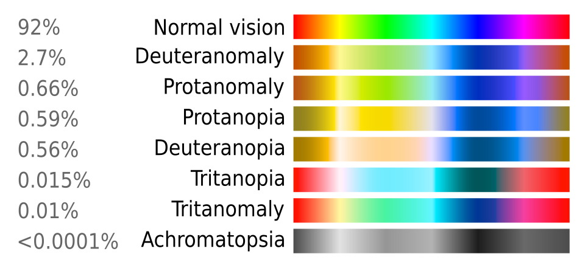
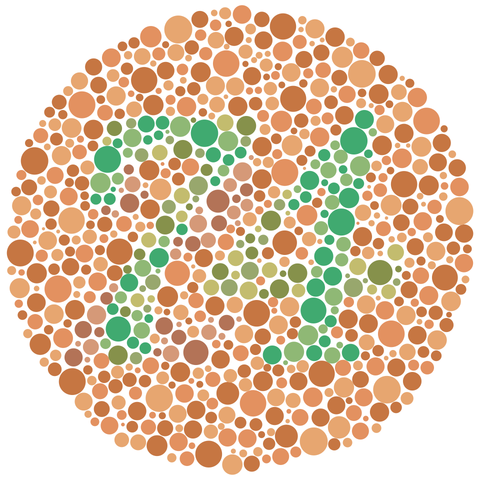
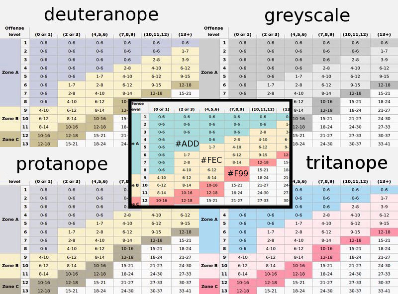
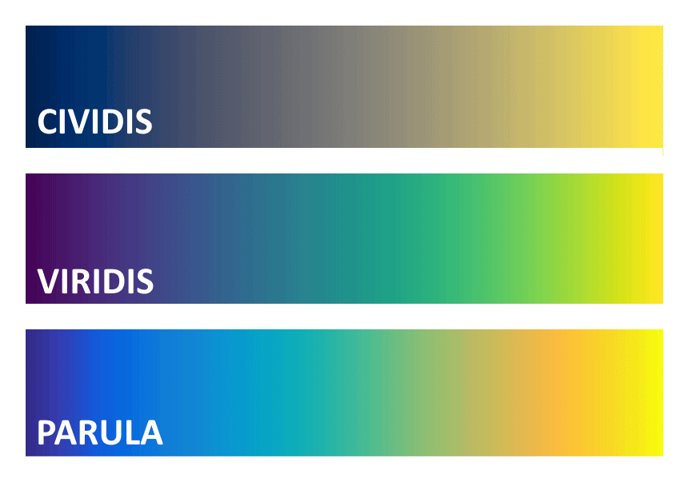

# Chapitre 37 — Daltonisme et déficiences de la vision des couleurs

*Figure 37.1 — Simulation de la vision selon le type de daltonisme. Wikimedia Commons (domaine
public).*

*Figure 37.2 — Planche d'Ishihara : une personne à la vision normale voit le chiffre « 74 » ; une
personne daltonienne rouge-vert verra probablement « 21 » [S51].*

## 37.1 De quoi parle-t-on ? [S51]

La **déficience de la vision des couleurs** (daltonisme, CVD) est la **capacité diminuée** à voir les
couleurs, leurs différences ou à distinguer des nuances. Sévérité : de **presque imperceptible** à
l'**absence totale** de perception des couleurs. Cause la plus fréquente : une **affection génétique liée
au chromosome X** (variation du fonctionnement de l'une des trois classes de **cônes** de la rétine).

- **Prévalence** : jusqu'à **1 homme sur 12 (8 %)** et **1 femme sur 200 (0,5 %)** pour le daltonisme
  **rouge-vert** (population d'origine nord-européenne) ;
- plus fréquent chez les hommes car les gènes d'opsines concernés sont **sur le chromosome X** ;
- formes plus rares : **bleu-jaune** (tritan), monochromatie à cônes bleus, achromatopsie ;
- peut aussi résulter de **dommages** à l'œil, au nerf optique, au cerveau ou de la **toxicité d'un
  médicament** ; la vision des couleurs **se dégrade naturellement avec l'âge** ;
- diagnostic : **test d'Ishihara** ; **pas de guérison** pour la plupart des causes ; les lunettes pour
  daltoniens aident pour certaines tâches mais ne donnent **pas** une « vision normale » ; certaines
  applis identifient les couleurs avec la caméra ;
- les formes légères n'affectent pas la vie quotidienne ; les personnes concernées **développent des
  stratégies d'adaptation**.

## 37.2 Classification [S51]

| Catégorie | Définition |
|---|---|
| **Monochromatie** | Un seul canal d'information de couleur ; aucune couleur distinguée, seulement des variations de luminosité (achromatopsie des bâtonnets ; monochromatie à cônes bleus) |
| **Dichromatie** | Deux couleurs primaires suffisent pour tout assortir : **protanopie**, **deutéranopie**, **tritanopie** (mots grecs : « incapacité de voir avec le 1ᵉʳ, 2ᵉ, 3ᵉ cône ») ; **2 % des hommes** ont de sévères difficultés à distinguer rouge, orange, jaune, vert |
| **Trichromatie anormale** | Forme la plus **légère** ; **environ trois fois plus fréquente** que la dichromatie ; protanomalie, deutéranomalie, tritanomalie |

Selon le cône atteint :
- **Rouge-vert** : *protan* (cône L) et *deutan* (cône M) ; couleurs de confusion typiques :
  **rouge / brun / vert / jaune** et **bleu / violet** ; aussi appelé *daltonisme* (John Dalton).
- **Bleu-jaune** : *tritan*.

*Figure 37.3 — Deutéranopie.*

*Figure 37.4 — Protanopie.*

*Figure 37.5 — Tritanopie. Wikimedia Commons (CC BY-SA 4.0).*

## 37.3 Conséquences de conception

1. **Ne jamais coder l'information par la couleur seule** (WCAG 1.4.1 [S48]) : ajouter **forme, texte,
   icône, motif, position**. Cas typiques à risque :
   - **rouge / vert** pour « erreur / réussite », « à valider / validé » — le couple le plus confondu ;
   - **vert / orange / rouge** pour des niveaux ;
   - **bleu / violet** et **rouge / marron** ;
   - **courbes de graphiques** distinguées uniquement par la teinte.
2. **S'appuyer sur la luminosité (valeur)** : la différence **clair/foncé** reste perçue (c'est pour cela
   que le contraste WCAG se calcule sur la luminance, chap. 9 [S45]).
3. **Doubler les états colorés** : ex. rouge **+ icône « ✕ »** / vert **+ icône « ✓ »** ; ligne
   « à valider » avec un pictogramme et un libellé.
4. **Graphiques** : motifs, marqueurs distincts, étiquettes directes plutôt que légende colorée.
   Les *palettes séquentielles* adaptées aux CVD existent (illustration Wikipédia) [S51].
5. **Simuler** : appliquer un filtre de simulation (protanopie, deutéranopie, tritanopie) ou passer
   en **niveaux de gris** pour vérifier que l'information survit.
6. **Respecter le mode contraste élevé / couleurs forcées** du système (`forced-colors`, chap. 32).

*Figure 37.6 — Test des couleurs d'un graphique web pour le daltonisme. Wikimedia Commons (CC BY-SA 3.0).*

*Figure 37.7 — Palettes séquentielles lisibles malgré une déficience de la vision des couleurs. Wikimedia Commons, Curran919 (CC BY-SA 4.0).*

## 37.4 Application à ScanList (exemple)

Le code couleur « rouge = à valider, vert = validé » (décision de l'utilisateur de l'app) est
**le couple le plus confondu en CVD rouge-vert**. Sans changer cette décision, on peut garantir
l'accessibilité en **ajoutant un second signal** : une icône de **case vide** / **case cochée**, ou un
libellé « À lire » / « Lu ». C'est la méthode recommandée par le critère 1.4.1 : **la couleur peut rester
l'indicateur principal, à condition qu'elle ne soit pas le seul** [S48].

## 37.5 Check-list
- [ ] Aucune information portée par rouge/vert (ni vert/orange/rouge) sans second signal.
- [ ] Graphiques lisibles en niveaux de gris.
- [ ] Contraste de valeur suffisant entre états.
- [ ] Simulation CVD réalisée (au moins deutan et protan).
- [ ] Couleurs forcées / contraste élevé testés.

---
*Sources du chapitre : S45, S48, S51.*
